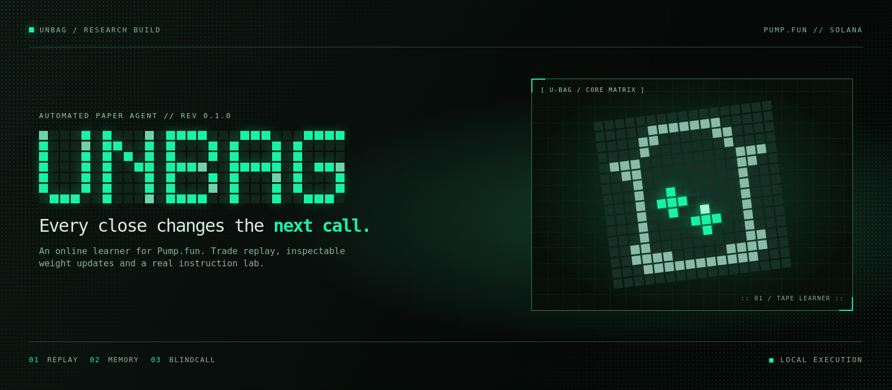
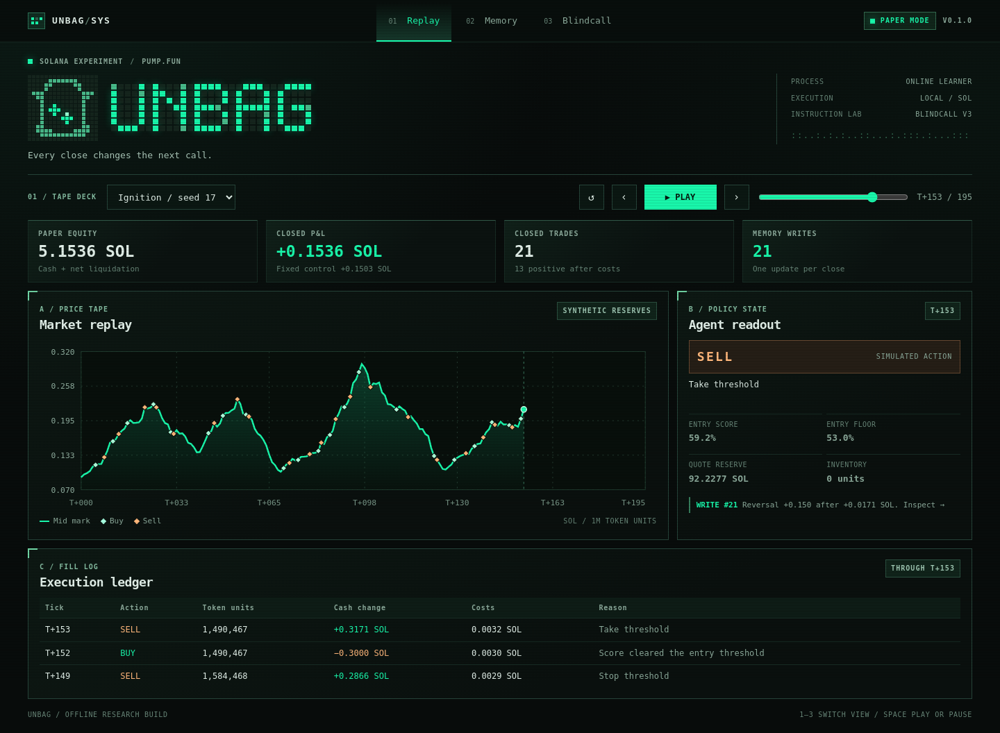
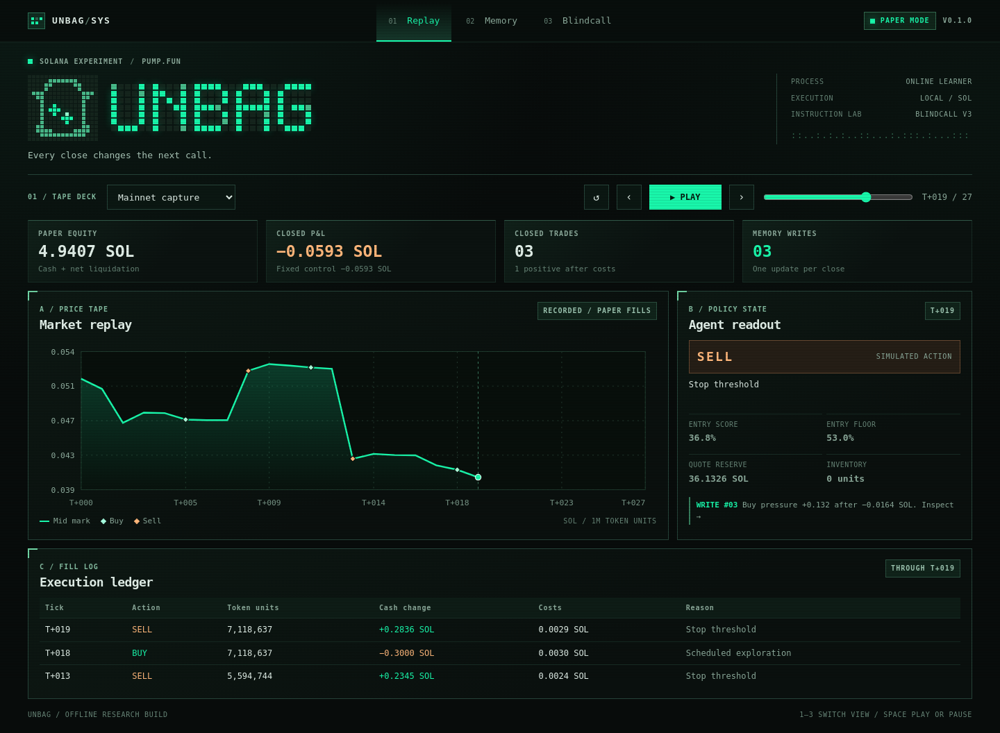
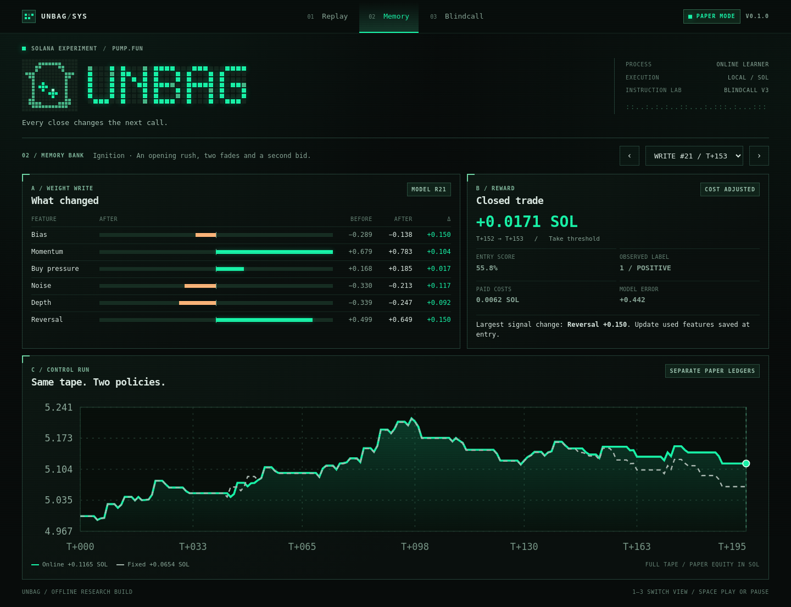
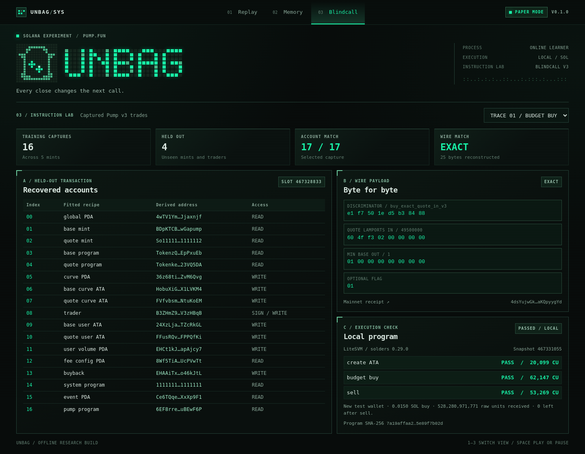

# Unbag

**An automated learning agent for Pump.fun. Every close changes the next call.**

Unbag opens and closes paper positions by itself. When a position closes, the model uses the result after costs to update the weights behind its next entry. The console lets you stop on any tick, inspect the fills and read the exact change each exit made to the model.

**Blindcall** is the separate instruction lab. It fits two Pump v3 trade layouts from finalized Solana transactions. It then checks unseen mints and traders and runs a new buy and sell against the captured Pump program in a local Solana bank.

| Replay | Memory | Blindcall |
| --- | --- | --- |
| Automated paper positions on synthetic and recorded reserve tapes | One model update per closed trade, with a fixed policy for comparison | 16 training receipts, 4 held-out receipts and a fresh local round trip |

## Run it

Download or clone the repository, then open **Unbag.html** in a browser. It works offline. Press **Play**, pick a tape or drag the timeline. Select **Memory** to inspect each model revision and **Blindcall** to view the real transaction evidence.

For the CLI, use Python 3.11+ from the repository root. The default commands use the standard library.

```sh
python -m unbag run --scenario ignition
python -m unbag run --tape evidence/pump-tape.json
python -m unbag blindcall
python -m unittest discover -s tests -v
```

To save the complete decision log and take learned weights into a new run:

```sh
python -m unbag run --scenario ignition --out runs/ignition.json --save-model runs/model.json
python -m unbag run --scenario undertow --checkpoint runs/model.json
```

Each new run starts with a fresh paper balance. A checkpoint carries weights and the lifetime update count. The fixed policy starts with the same weights as the learner and leaves them unchanged.

## 01 / Replay



The agent gets a reserve snapshot and a short window of trade direction. It scores an entry, respects a cash and liquidity guard and holds one position at a time. Each open position has an exit deadline and stop and take thresholds. The ledger records the actual paper cash movement and estimated costs.

The fourth tape is **Mainnet capture**. It replays 28 finalized reserve observations decoded from Pump v3 trades for one mint. Its prices come from recorded reserve fields; Unbag's fills and outcomes remain hypothetical. The capture file lists the source signature for every observation.



## 02 / Memory



Unbag uses a small online logistic model. At entry, it saves the features and score it acted on. At exit, it labels the position from its net SOL result and takes one gradient step. The console shows the old weights, new weights, difference and the trade that produced the update.

The fixed baseline sees the same reserve tape and has the same budget and exit rules. These are reproducible examples, with outcomes in paper SOL:

| Tape | Closed trades | Updates | Online net SOL | Fixed net SOL |
| --- | ---: | ---: | ---: | ---: |
| Ignition | 25 | 25 | +0.116529 | +0.065364 |
| Undertow | 19 | 19 | −0.062221 | +0.035967 |
| Whipsaw | 19 | 19 | −0.125082 | −0.215196 |
| Mainnet capture | 3 | 3 | −0.059254 | −0.059254 |

Undertow is the counterexample: the agent learned from 19 trades and still finished behind the fixed policy. See the [stress screenshot](./Unbag-Stress.png), [model details](./docs/MODEL.md) and [results notes](./docs/RESULTS.md).

## 03 / Blindcall



Blindcall resolves accounts from Solana RPC messages, then matches each Pump instruction position to a vocabulary of address recipes. Its input context comes from token balance changes and the documented buyback recipients. The fit learns account order and instruction prefixes from examples. Address seeds and the two integer argument types are supplied as prior knowledge.

- **Fit:** 10 budget buys and 6 sells across 5 mints.
- **Holdout:** 4 finalized transactions across 2 mints absent from the fit, with traders also absent from the fit. All 17 accounts matched in order and every instruction payload matched byte for byte.
- **Execution:** a fresh test wallet created its token account, bought with 0.015 SOL of local test balance, then sold the entire resulting token balance. The test ran on LiteSVM using the captured curve accounts and the matching deployed program binary. The receipt records the program hash and compute units.

To rerun the local execution check:

```sh
python -m pip install -r requirements-proof.txt
python scripts/local_proof.py
```

That command fetches the pinned program bytes from a read-only RPC. If the deployed program has changed, pass a matching saved binary with `--program-file`. The default offline Blindcall check works from the bundled captures. See [evidence and exact scope](./docs/BLINDCALL.md).

## Project files

| Path | What it contains |
| --- | --- |
| [Unbag.html](./Unbag.html) | Standalone CRT console with a real engine replay embedded |
| [unbag/](./unbag/) | Online model, paper fills, instruction fitting and read-only capture |
| [evidence/](./evidence/) | Raw finalized receipts, one reserve tape, the curve snapshot and local proof |
| [web/](./web/) | Browser source, original dot-matrix glyphs and the cover |
| [scripts/](./scripts/) | Local proof, reserve capture and screenshot reproduction |
| [tests/](./tests/) | Learning, accounting, lookahead and instruction tests |
| [docs/](./docs/) | Model, results, evidence and development notes |
| [GITHUB.md](./GITHUB.md) | Repository description, commit text and upload steps |

The learning engine uses a paper ledger. The separate instruction proof executes inside a local bank. No path in Unbag broadcasts a trade or requires a funded wallet. The paper model uses simplified fill and fee assumptions, and the included results do not establish a trading edge.

Independent research project. [MIT licence](./LICENSE) for Unbag source and original artwork. [Icon](./Unbag-Mark.png) · [Development](./docs/DEVELOPMENT.md)
